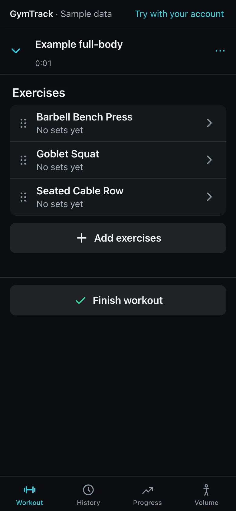
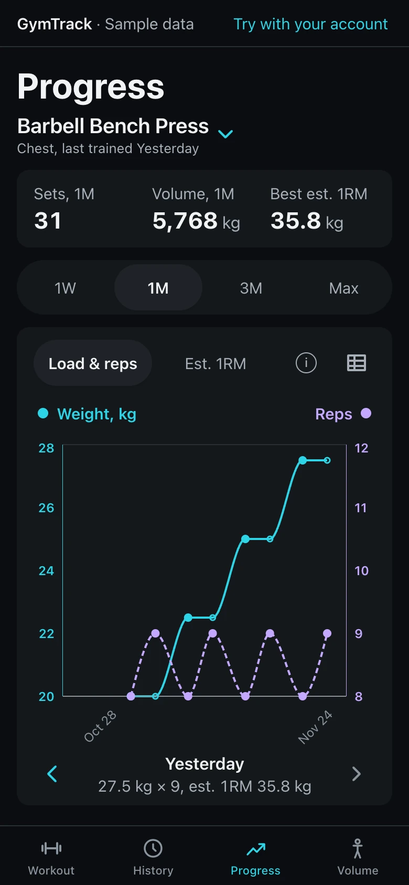
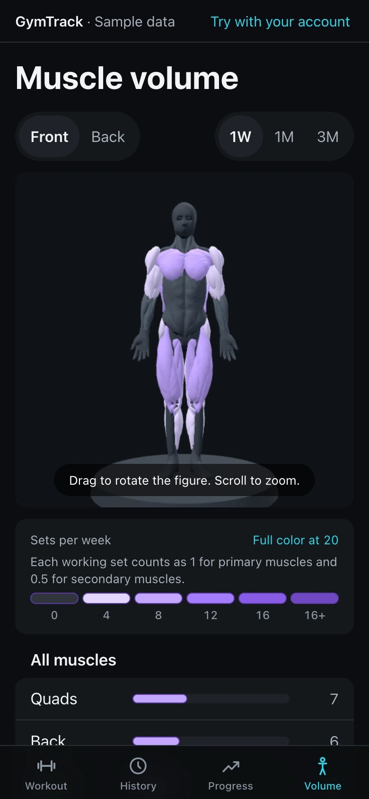
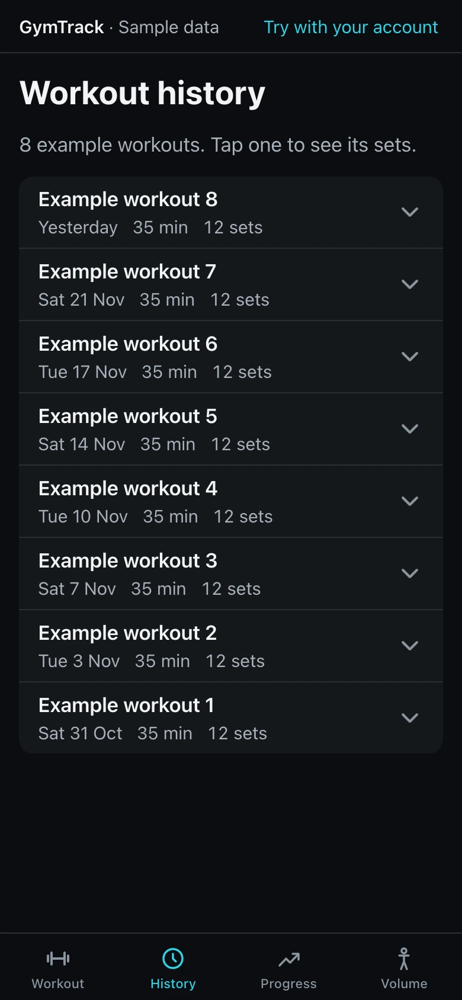
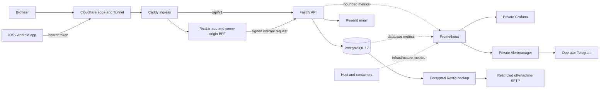

# Gym Progress Tracker

[](https://github.com/haagjjan/gym-track/actions/workflows/repo-checks.yml)
[](https://status.gymtrack.ch)
[](https://status.gymtrack.ch)
[](https://status.gymtrack.ch)
[](LICENSE)

Gym Progress Tracker (GymTrack) is a mobile-first strength-training log for recording workouts
quickly, reusing templates, tracking exercise progress, and inspecting weekly muscle volume on a
3D body.

This repository contains the web app, Capacitor iOS and Android projects, Fastify API, PostgreSQL
migrations, authentication and privacy workflows, admin tools, tests, self-hosted production and
staging definitions, monitoring, alerting, encrypted backups, and the independent status page.

> **Current release stage:** public v0 at [app.gymtrack.ch](https://app.gymtrack.ch). Signup is
> open to adults who live in Switzerland
> ([ADR 0022](docs/decisions/0022-open-public-registration.md)). The phone UX rework is complete
> ([design system](docs/DESIGN.md)), and the Capacitor iOS and Android projects live in
> `apps/mobile` ([ADR 0021](docs/decisions/0021-mobile-app-stack.md),
> [mobile app guide](docs/mobile-app.md)), awaiting production API rollout and store submission.

[Create an account](https://app.gymtrack.ch/signup) ·
[Status & live activity](https://status.gymtrack.ch) ·
[Current project state](docs/99-current-project-state.md) ·
[Security policy](SECURITY.md)

## Preview

| Workout | Progress | Muscle volume | History |
| :---: | :---: | :---: | :---: |
|  |  |  |  |

Captures from the built-in sample-data demo (no real member data). Live service health, recent
weekly activity, and an interactive preview are published at
[status.gymtrack.ch](https://status.gymtrack.ch).

## The product

The core workflow stays direct:

1. Start a workout from scratch or from a reusable template.
2. Search and add exercises from the reviewed catalog.
3. Log warm-up and working sets with weight (including `0 kg` for bodyweight work), reps, reps in
   reserve (RIR), and notes.
4. Finish the workout and review it in History.
5. Check Progress and Weekly Volume to see how training changes over time.

### Training and analysis

- Mobile-first live workout logging with previous-performance context, set editing in sheets,
  exercise reordering, a rest timer, and local recovery of an unfinished set draft.
- Ordered workout templates that can be created, duplicated, updated, and started directly.
- A reviewed 840-exercise system catalog mapped across 20 muscle regions, with aliases,
  typo-tolerant search, muscle/equipment/type facets, and controlled custom exercises.
- Optional time-based sets and cardio tracking behind `ENABLE_EXTENDED_TRACKING`
  ([ADR 0026](docs/decisions/0026-time-and-cardio-tracking.md)).
- Workout history and detail, plus a documented canonical CSV import/export format with preview.
- Exercise Progress time plot with 1W/1M/3M/Max spans, pan/tap daily inspection, range totals,
  tonnage, best set, and estimated one-repetition max.
- Weekly muscle-volume analysis on a shared 3D body model with 20 named muscle regions, weighted
  set credit (1.0 primary, 0.5 secondary; [ADR 0028](docs/decisions/0028-secondary-muscle-volume.md)),
  and a configurable heat ceiling.
- A guided in-app example workout for new accounts ([ADR 0020](docs/decisions/0020-hands-on-onboarding-demo.md))
  and a public sample-data preview at `/demo`.
- Tab-bar navigation on phones (Home, History, Workout, Progress, Volume), a sidebar on wide
  screens, and light/dark themes.
- Native iOS and Android shells (`apps/mobile`) sharing the web screens, with offline workout
  logging via a local SQLite cache and mutation outbox ([ADR 0025](docs/decisions/0025-offline-sync.md)),
  haptics, rest-timer reminders, and universal/app links.

### Accounts, privacy and administration

- Argon2id passwords, opaque database-backed sessions, secure cookies, login lockout, email
  verification, and password recovery.
- Flagged bearer-token authentication for the mobile apps (`ENABLE_MOBILE_TOKEN_AUTH`,
  [ADR 0023](docs/decisions/0023-mobile-token-auth.md)) and flagged Sign in with Apple and Google
  ([ADR 0029](docs/decisions/0029-apple-and-google-sign-in.md)).
- Open registration with age, residence, and policy confirmation at signup, plus a `DISABLED` kill
  switch.
- Account preferences, explicit device-storage choice, JSON export, deletion grace/cancellation,
  and hard erasure with shared-exercise anonymization.
- Administrator tools: usage overview with exact counts and per-account activity, user status,
  session revocation, deletion support, campaigns, and audit history.
- In-app messages and campaigns for members, with controlled publication, pause/end behavior, and
  bounded responses.
- Public Privacy, Terms, Cookie/Storage, and Support pages driven by runtime configuration rather
  than values baked into the image.

GymTrack has no advertising SDK, social feed, or third-party browser analytics. It is a training
log and analysis tool, not medical advice or an automated coaching system.

## Architecture

The browser-facing application is a same-origin system. Production does not expose PostgreSQL
directly; the web app proxies through its Next.js BFF, and the mobile apps talk to the Fastify API
using Keychain/Keystore-backed bearer tokens when enabled.



The Next.js BFF owns browser ingress, Host/Origin checks, and edge-derived client attribution.
Fastify owns authentication, authorization, business transactions, and persistence. Kysely keeps
queries inside feature repositories, Zod validates runtime boundaries, and SQL migrations remain
the durable schema source of truth.

| Layer | Main technology |
| --- | --- |
| Web | Next.js 15 App Router, React 19, Tailwind CSS 4, TanStack Query, Recharts, Three.js / React Three Fiber |
| Mobile | Next.js static export, Capacitor 8 (iOS & Android), SQLite offline cache/outbox, Keychain/Keystore storage |
| API | Fastify 5, Zod, Kysely, Argon2, Papa Parse, `prom-client` |
| Data | PostgreSQL 17, `node-pg-migrate`, SQL constraints and indexes |
| Tooling | TypeScript 5.9, pnpm 10 workspaces, ESLint, Docker Compose |
| Verification | Node test runner, PostgreSQL integration tests, Playwright, axe, c8 line coverage |
| Operations | Caddy, Cloudflare Tunnel, Better Stack, Prometheus, Grafana, Alertmanager, Restic, systemd |

For boundary and dependency rules, read [ARCHITECTURE.md](ARCHITECTURE.md). For the current code
map and state, read [CODEBASE.md](CODEBASE.md) and
[docs/99-current-project-state.md](docs/99-current-project-state.md).

## Repository map

```text
apps/
  api/                 Fastify features, repositories, migrations and tests
  web/                 Next.js pages, BFF routes, product UI and browser tests
  mobile/              Static export wrapper, Capacitor iOS/Android projects and offline sync
ops/
  production/          Reviewed production Compose/Caddy definition and runbook
  staging/             Isolated production-shaped staging definition and runbook
  monitoring/          Prometheus, Grafana, Alertmanager and exporters
  logging/             Bounded log review, audit and retention tooling
  backup/              Encrypted backup, restore tests, timers and Mac destination setup
  status/              Independent live status, activity and build-evidence page
docs/
  decisions/           Architecture decision records (ADR 0001–0030)
  beta-process/        Live privacy documents (data inventory, retention, DPIA, processors)
  server/              Live recovery runbooks and the Grafana guide
  store/               App Store and Google Play listing and privacy materials
  archive/             Finished plans, reports and old UI references (see its README)
tools/
  body-model/          3D anatomical body build and validation scripts
scripts/
  mobile-preview.sh    Capacitor dev shell for the iOS Simulator and Android emulator
```

Root configuration owns workspace tooling, local Docker Compose, CI, engineering rules, and the
retained Render deployment alternative. The path-by-path map is in
[docs/repository-structure.md](docs/repository-structure.md).

## Run locally

### Requirements

- Node.js 22 or newer
- pnpm 10 or newer
- Docker with the Compose plugin

### Production-like local stack

```sh
git clone https://github.com/haagjjan/gym-track.git
cd gym-track
pnpm install
cp .env.example .env
pnpm start
```

Open [http://localhost:3000](http://localhost:3000). The stack starts PostgreSQL, applies all
migrations, and starts the API and web application. Local registration is enabled by default.

When `RESEND_API_KEY` is empty, local email action links are written to the API log instead of sent.
Empty controller/contact values deliberately show `PUBLICATION_BLOCKED` on legal pages; fill the
local `.env` if those pages need realistic rendering.

Stop the stack with:

```sh
pnpm stop
```

### Split development mode

Use Docker only for PostgreSQL, then run both applications with hot reload:

```sh
pnpm db:start
pnpm migrate:up
pnpm dev:api
pnpm dev:web
```

The API defaults to `http://localhost:4000`; the web application defaults to
`http://localhost:3000`. `tsx watch` does not read `.env` by itself, so load it into the shell
before `pnpm dev:api` (`set -a && . ./.env && set +a`).

To build and run the bundled Capacitor app on the iOS Simulator or Android emulator, follow
[docs/mobile-app.md](docs/mobile-app.md). For quick web-server checks inside the phone shells while
`pnpm dev:web` is running, use `scripts/mobile-preview.sh [all|ios|android]`.

## Verification

The normal repository gate is:

```sh
pnpm check
```

It runs strict type checking, linting, unit tests (including mobile route parity and status page
data tests), and production builds across all workspace packages. Additional risk-specific gates
run separately:

```sh
pnpm test:performance     # sequential algorithmic regression workloads
pnpm test:integration     # real PostgreSQL auth/workout/admin flows
pnpm smoke:web            # Playwright member workflow, responsive and accessibility checks
pnpm test:status:browser  # Chromium/Firefox checks for the independent status page
```

GitHub Actions runs Project checks, status browser checks, API database integration, and Web smoke
as separate jobs for every pull request and push to `main`. CI also verifies fresh staging
PostgreSQL initialization, the hardened offline runtime, and production/staging Compose invariants.
After a green `main` workflow, the status workflow collects API/web line coverage, creates
attributable build evidence, validates the static boundary, and publishes the GitHub Pages bundle
at [status.gymtrack.ch](https://status.gymtrack.ch).

The performance suites are regression ceilings rather than browser Core Web Vitals or a claim of
large-scale capacity. Production-shaped staging separately passed the Founding Beta target of 20
concurrent active loggers and a 40-logger 2x probe.

## Environments and operations

| Environment | Purpose | Exposure | Data |
| --- | --- | --- | --- |
| Local Compose | feature development and tests | localhost | disposable developer data |
| Staging | exact-SHA, production-shaped acceptance | owner-only Cloudflare Access | synthetic only |
| Production | public v0 | `app.gymtrack.ch` through Cloudflare Tunnel | real member data |
| Status | independent incident communication, live activity and build evidence | public GitHub Pages (`status.gymtrack.ch`) | aggregate counts only, no personal data |

Production is self-hosted on a 2018 Intel Mac mini running Ubuntu 26.04 with a T2-compatible
kernel. The application, database, ingress, and monitoring services run as a hardened Docker
Compose project. Staging uses separate services, networks, credentials, and storage under its own
server root on the same physical host.

Production monitoring keeps six Prometheus targets internal, provisions three private Grafana
dashboards, and evaluates 31 alert rules. Logs are structured, redacted, and bounded. Encrypted
Restic backups have four daily opportunities, strict 30-day off-machine retention, and isolated
PostgreSQL/configuration/erasure-ledger restore tests.

Deployment is intentionally not reduced to a copy-paste command in this README. Exact-SHA CI,
backup preflight, migrations, immutable images, health waits, rollback capture, and external
verification are required. Use the reviewed runbooks:

- [Production operations](ops/production/README.md)
- [Staging operations](ops/staging/README.md)
- [Monitoring](ops/monitoring/README.md)
- [Logging](ops/logging/README.md)
- [Backup and recovery](ops/backup/README.md)
- [External status page](ops/status/README.md)

Render configuration remains in the repository as an alternative deployment path; it is not the
active production platform.

## Project status and boundaries

Public v0 is English-only and open to adults who live in Switzerland. The closed Founding Beta
before it closed every launch gate, including production security, data lifecycle, restore,
capacity, real-device, email, incident, and status-page rehearsals. This repository does not claim:

- high availability or automatic failover;
- readiness for arbitrary or hostile Internet scale;
- independent penetration-test certification;
- medical, legal, or professional training advice;
- complete assistive-technology coverage beyond the documented scope.

The Founding Beta gate evidence and rollout stop rules are in
[docs/archive/beta-process/public-beta/goal-1/launch-gates.md](docs/archive/beta-process/public-beta/goal-1/launch-gates.md).

## Documentation guide

Start here depending on the question:

| Question | Document |
| --- | --- |
| Where does the project stand now? | [Current project state](docs/99-current-project-state.md) and [current system analysis](docs/current-system-analysis.md) |
| What should the product do? | [Product requirements](docs/01-requirements.md) |
| How are code boundaries organized? | [Architecture](ARCHITECTURE.md) and [implementation pattern](docs/07-implementation-pattern.md) |
| Why were major choices made? | [Architecture decisions](docs/decisions/README.md) |
| How are the iOS and Android apps built? | [Mobile app guide](docs/mobile-app.md) |
| What does the data model support? | [Query list](docs/02-query-list.md), [data notes](docs/03-data-model-notes.md), [schema](docs/04-schema-draft.md) |
| What does the API expose? | [API contract](docs/05-api-contract.md) |
| What did the Founding Beta prove? | [Launch gates](docs/archive/beta-process/public-beta/goal-1/launch-gates.md) and [Goal 5 closure](docs/archive/beta-process/public-beta/goal-5/goal-5-scope.md) |
| How is the server operated or recovered? | [Production operations](ops/production/README.md), [operator guide](docs/13-operator-guide.md), and [disaster recovery](docs/server/disaster-recovery.md) |
| How should the UI look and read? | [Design system](docs/DESIGN.md) |
| Where is the code? | [Codebase map](CODEBASE.md) and [repository structure](docs/repository-structure.md) |
| How should changes be made? | [Engineering rules](ENGINEERING.md) and [Contributing](CONTRIBUTING.md) |

Finished roadmaps, briefs, and execution reports live in [docs/archive](docs/archive/README.md).
They keep the state at the time they were written. When they disagree with the current docs, the
ADRs, or the code, the current material wins.

## Security

Please report vulnerabilities privately to **security@gymtrack.ch**. Do not test against another
member's data or run disruptive automation against the live service. Full scope, expectations, and
safe-testing boundaries are in [SECURITY.md](SECURITY.md).

## Contributing

This is currently a single-owner project, but focused issues and pull requests are welcome. Read
[CONTRIBUTING.md](CONTRIBUTING.md) and [ENGINEERING.md](ENGINEERING.md) before changing application
code. Architecture, schema, authentication, API, or deployment-direction changes require an ADR.

## License

Source code is available under the [MIT License](LICENSE). Bundled 3D assets, exercise-source data,
and other third-party material have separate attribution or license terms recorded in
[NOTICE](NOTICE).
